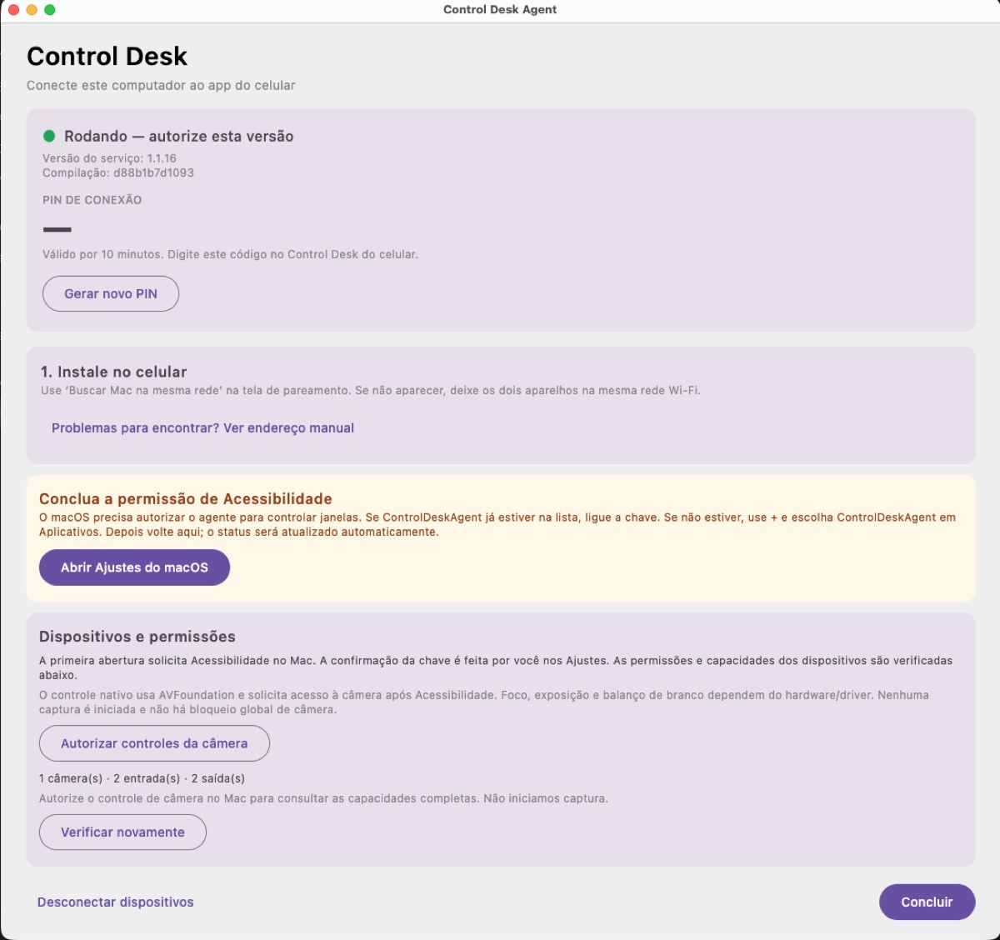
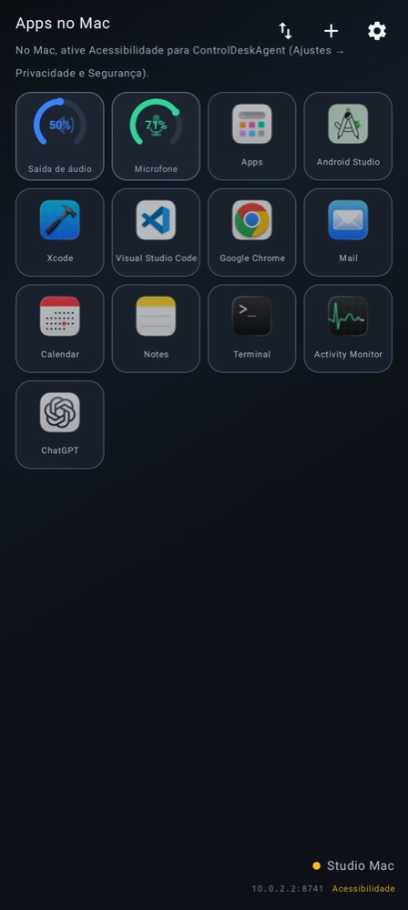
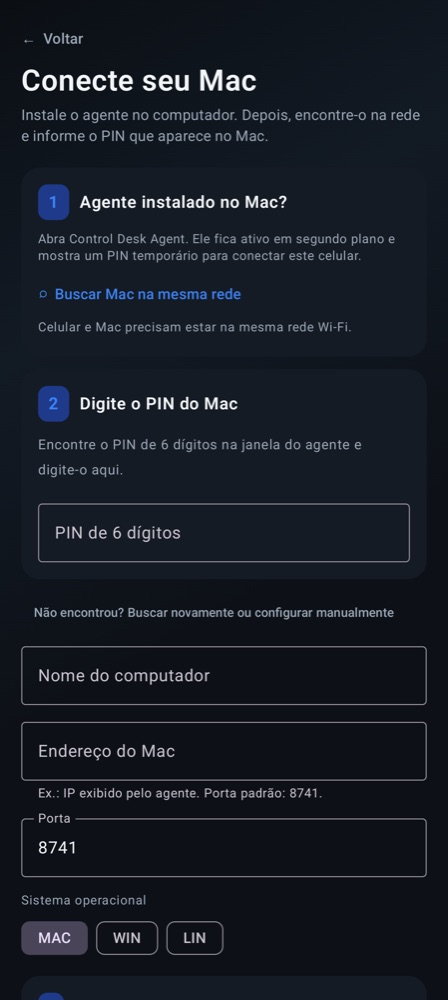

# Control Desk

Painel remoto estilo Stream Deck — celular controla Mac/PC na LAN.

**Documentação completa:** **[docs/README.md](docs/README.md)**

## Telas

| Agente no Mac | Grade no celular | Pareamento |
|:---:|:---:|:---:|
|  |  |  |

- **Agente (Mac):** serviço em segundo plano que mostra o PIN temporário de conexão e o estado das permissões.
- **Grade (celular):** abre apps, controla volume e microfone do computador pela rede local.
- **Pareamento:** o celular encontra o Mac na rede e conecta com o PIN de 6 dígitos exibido no agente.
