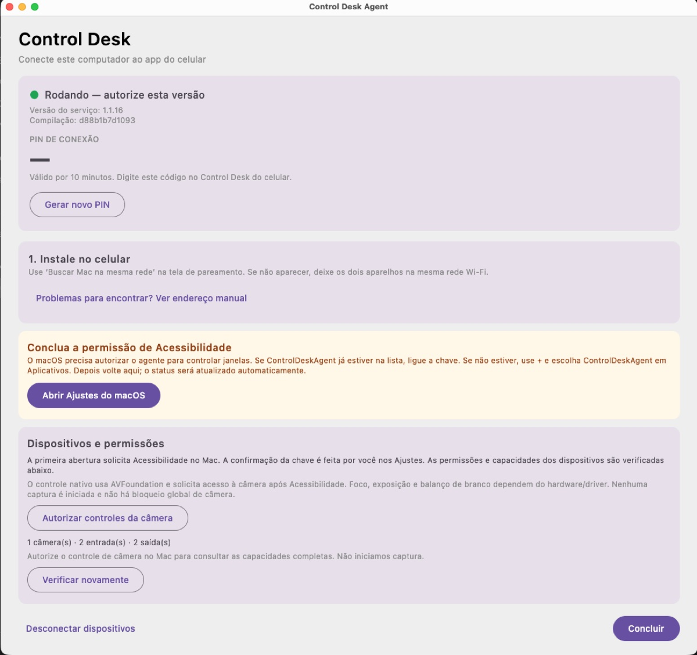
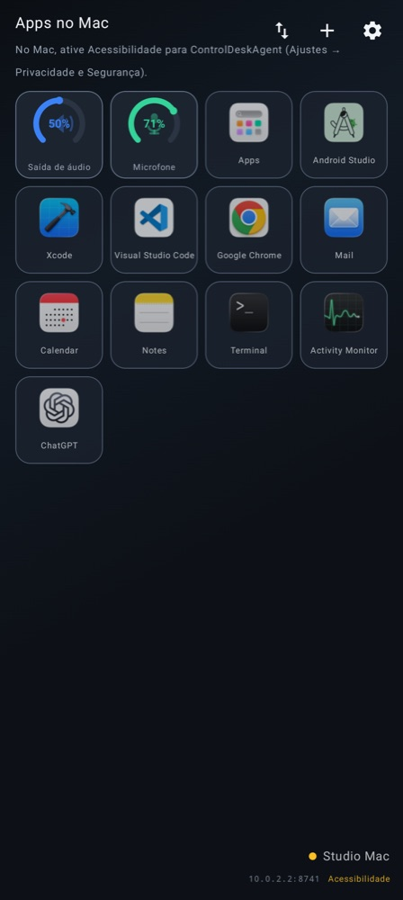
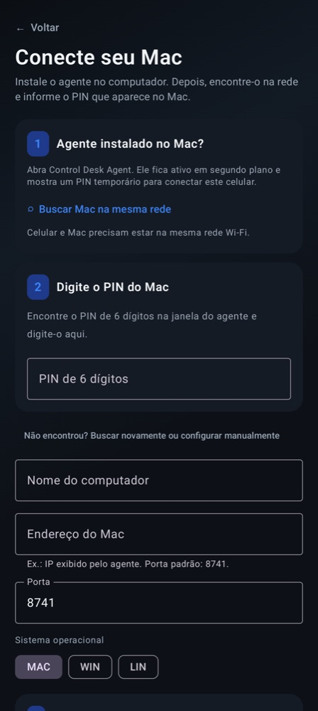

# Control Desk

Painel remoto para controlar um Mac pela rede local, com apps Android/iOS em Kotlin Multiplatform e agente desktop JVM. Permite focar e encerrar apps, selecionar abas do Chrome e ajustar volume e microfone.

**Documentação completa:** **[docs/README.md](docs/README.md)**

## Telas

| Agente no Mac | Grade no celular | Pareamento |
|:---:|:---:|:---:|
|  |  |  |

- **Agente (Mac):** serviço em segundo plano que mostra o PIN temporário de conexão e o estado das permissões.
- **Grade (celular):** abre apps, controla volume e microfone do computador pela rede local.
- **Pareamento:** o celular encontra o Mac na rede e conecta com o PIN de 6 dígitos exibido no agente.

O controle nativo de apps está implementado para **macOS**. Apps e áudio legado Windows/Linux usam um executor simulado; os adaptadores de dispositivos têm suporte nativo parcial conforme a plataforma. O iOS tem framework e fontes Swift, mas ainda exige criar o projeto Xcode.

## Desenvolvimento

Requisitos: **JDK 21**, Android SDK 35 para Android e Xcode para iOS. Use o Gradle Wrapper do repositório.

```bash
./gradlew :core:domain:jvmTest :core:protocol:jvmTest :core:data:jvmTest :agent:test
./gradlew :composeApp:assembleDebug
CONTROL_DESK_NO_RESPAWN=1 ./gradlew :agent:run
```

O último comando abre o agente e sua janela de configuração. A opção desativa o respawn ao encerrar a execução de desenvolvimento. Pareie o celular usando IP LAN do Mac, porta `8741` e PIN mostrado pelo agente; no emulador Android use `10.0.2.2`.

## Documentação

- [Índice e comandos](docs/README.md)
- [Arquitetura e estado atual](docs/architecture.md)
- [Features implementadas e próximas](docs/feature-status.md)
- [Revisão geral, riscos e prioridades](docs/review.md)
- [API e especificação](docs/spec.md)
- [Instalação macOS](docs/agent-install.md)
- [Configuração iOS](docs/ios-setup.md)
- [Roadmap](docs/roadmap.md)

O mobile mantém launchers persistentes por aplicativo, com ícones reais, tamanho e ordem salvos por computador. As janelas são instâncias selecionáveis por título e monitor; abrir ou fechar uma janela não substitui o launcher. Favoritos de projeto recebem somente as janelas correspondentes. Para instalação atualizada, consulte [a revisão geral](docs/review.md) e [o catálogo de features](docs/feature-status.md).

Microfone e saída de áudio podem ser organizados e redimensionados junto aos apps. O cadastro também oferece atalhos de câmera/dispositivo por aplicativo ou URL, executados pelo agente. O agente 1.1.15 também lista dispositivos e oferece controles nativos conforme as capacidades do sistema; veja [atalhos de dispositivos](docs/device-shortcuts.md).


Câmeras e dispositivos podem usar **Abrir todos os controles**: um único atalho abre o painel Material 3 de capacidades e estados confirmados, com ações diretas opcionais. No Mac, a versão 1.1.15 inclui autorização e modos nativos de foco, exposição e balanço de branco conforme o driver; não oferece bloqueio global nem captura. Consulte [documentação de dispositivos](docs/device-shortcuts.md).
