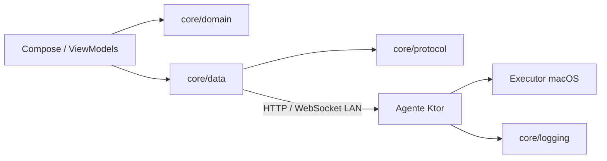

# Arquitetura e estado atual

Revisão do checkout em 13/10/2026. Este documento descreve os módulos e o fluxo; o catálogo por estado está em [feature-status.md](feature-status.md), as próximas entregas no [roadmap](roadmap.md) e riscos em [review.md](review.md).

## Módulos

| Módulo | Responsabilidade |
|---|---|
| `composeApp` | Compose Multiplatform, telas Desk/Pair, ViewModels, integração Android/iOS e Koin |
| `core/domain` | Modelos, interfaces de repositório e casos de uso de pareamento/execução |
| `core/protocol` | DTOs serializáveis, cliente HTTP e mensagens WebSocket |
| `core/data` | Gateway HTTP, cliente WebSocket, persistência JSON e construção da grade |
| `core/logging` | Kermit, Crashlytics Android e envio de Warn/Error JVM ao Firestore |
| `core/testing` | Fakes compartilhados |
| `agent` | Ktor CIO, autenticação, eventos, executor macOS e janela Compose Desktop |

Kotlin 2.1.21, Compose Multiplatform 1.8.2, Ktor 3.1.3 e Koin 4.1.0 são versões fixadas em `gradle/libs.versions.toml`. App Android e módulos gerais usam toolchain JDK 21; o agente e os módulos JVM que ele empacota geram bytecode Java 17 para coincidir com o runtime compacto distribuído no DMG. Android: SDK mínimo 26, compile/target 35. O framework estático iOS se chama `ComposeApp`, com targets arm64, simulator arm64 e x64.

## Plataformas

O macOS tem integração com janelas, Dock, foco, encerramento de apps, Chrome e áudio. A listagem é por janela e inclui seu título; o app mobile mostra esse título para distinguir projetos/janelas do mesmo aplicativo, com o nome do app como fallback. IDs incorporam PID e identidade da janela para manter instâncias separadas. A listagem é cadenciada a 1 s e os ícones pendentes são resolvidos em worker separado; a chegada de ícones invalida a assinatura do WebSocket para atualizar os clientes conectados. Acessibilidade é necessária para operações de janelas e o estado é consultado no próprio processo via `AXIsProcessTrusted`; automações AppleScript podem exigir autorização adicional do macOS. Windows/Linux delegam a `LoggingPlatformExecutor`: Safari/Notes e níveis de áudio simulados.

Android tem launcher próprio e modo painel. O PIN administrativo fixo `8741` abre as configurações nesse modo; ele é distinto do PIN de seis dígitos do agente e não constitui autenticação do protocolo. iOS contém fontes Swift e `Info.plist`, sem `.xcodeproj` ou `.xcworkspace` no repositório; consulte [ios-setup.md](ios-setup.md).

## Fluxo e transporte

1. O agente escuta em `0.0.0.0:8741` por padrão e anuncia `_controldesk._tcp` na interface da rota padrão do Mac. Isso evita prender o mDNS ao loopback quando o hostname local resolve para `127.0.0.1`. Android (NSD) e iOS (Bonjour) procuram agentes por alguns segundos na tela de pareamento; ao selecionar um resultado, host/porta/nome são preenchidos e o PIN continua sendo digitado pelo usuário. A entrada manual permanece como alternativa.
2. O usuário consulta o PIN localmente e envia `POST /pair`; o agente retorna um token persistente.
3. O app persiste o host e usa HTTP com Bearer para leitura/ações, além de conectar a `/ws?token=…`.
4. O WebSocket recebe snapshots de apps e áudio; comandos usam `id`, e o servidor devolve `ack` ou `error`. A UI aplica estado otimista e reconcilia com o agente.
5. Sem WebSocket conectado, o ViewModel usa polling HTTP. Se o WebSocket estiver desconectado antes de iniciar uma ação, ou a sessão desaparecer antes do envio, o app usa HTTP. Falha de envio ou timeout depois que uma ação começa pelo WebSocket é tratado como resultado não confirmado e não dispara a mesma ação novamente por HTTP; leituras HTTP continuam permitidas para atualizar o estado.

HTTP/WS são usados sem TLS. O PIN expira 10 minutos após geração. `/pair` permite até cinco PINs inválidos por endereço em uma janela de cinco minutos; o bloqueio se encerra após a janela ou após pareamento bem-sucedido. `/setup/health` confirma o estado do serviço para o processo local sem retornar o PIN; `/setup` retorna a configuração somente em localhost. Em localhost, `/setup/revoke-tokens` revoga todos os tokens e desconecta as sessões WebSocket. Remover um host no mobile remove apenas seus dados locais. Ainda não há revogação individual, expiração de tokens, TLS nem armazenamento protegido. mDNS é apenas descoberta; os comandos continuam em HTTP/WS e o telefone ainda precisa do PIN que aparece no agente.

## WebSocket

Contrato: `core/protocol/.../AgentWsMessages.kt`. Autenticação é validada ao abrir a sessão. Snapshots iniciais: `apps` e `audio`.

| Mensagem do cliente | Payload |
|---|---|
| `ping` | `id` opcional; resposta `pong` |
| `request_apps` | `requestIcons` |
| `launch` / `close` | `launch` / `close` com DTO de app |
| `switch_tab` | `tab` |
| `volume` / `mic` | `volume` / `mic` |
| `browser_open` / `browser_close` | `browser` / `browserClose` |

O servidor envia `apps`, `audio`, `ack` e `error`. `health` está definido no contrato, mas não é emitido pelo hub atual. O watcher consulta apps a cada 50 ms e áudio a cada dois ciclos, quando há sessões, publicando alterações por assinatura. Esses intervalos são delays do código, sem garantia de latência total.

Cliente: reconexão após 500 ms; timeout de comando de 2.500 ms. Estado `Connected` é definido após o handshake, antes de receber o snapshot autenticado. Respostas de erro falham o comando; pendências são limpas em todos os caminhos de conclusão. Veja validação em [review.md](review.md).

## Dados e operação

Android salva `control_desk_hosts.json` e `control_desk_icon_cache_v2.json` no `filesDir`; iOS usa Documents. Hosts incluem token e botões. O agente salva `agent_tokens.txt`, `agent_pin.txt`, logs e ícones versionados em `~/.control-desk/`. Tokens são armazenados em texto simples/JSON, sem camada de criptografia implementada. A grade mobile monta linhas explícitas cujas células têm pesos iguais; a última linha mantém espaços vazios para preservar o alinhamento das colunas.

O app macOS empacotado instala/atualiza LaunchAgent e abre configurações por padrão. `--headless` executa sem janela; `--settings` solicita configurações e `--no-settings` as suprime. Variáveis relevantes:

| Variável | Função |
|---|---|
| `CONTROL_DESK_PORT` | Porta do agente; padrão 8741 |
| `CONTROL_DESK_BIND` | Interface de escuta; padrão 0.0.0.0 |
| `CONTROL_DESK_HEADLESS` | Executar sem janela (`1`/`true`) |
| `CONTROL_DESK_OPEN_SETTINGS` | Controlar abertura de configurações (`1`/`true`) |
| `CONTROL_DESK_SKIP_INSTALL` | Evitar instalação automática do app empacotado |
| `CONTROL_DESK_NO_RESPAWN` | Desativar respawn em desenvolvimento (`1`) |

O pacote, `/health` e o TXT mDNS usam a versão `1.1.1`. O DMG contém app, atalho Applications e LEIA-ME; não inclui `docs/`. Os logs JVM Warn/Error podem ser enviados ao Firestore quando há configuração Firebase no classpath; a comunicação de controle na LAN não elimina essa telemetria.
